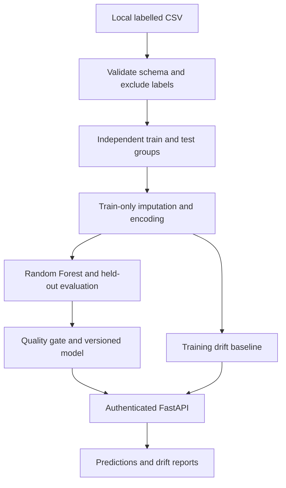

# ThreatGuard ML

Secure AI-Based Network Intrusion Detection System — DevSecMLOps Internal 2.

A reproducible Random Forest pipeline with train-only preprocessing, held-out evaluation,
versioned local artifacts, authenticated FastAPI inference, and bounded input drift monitoring.

## Problem and objectives
Network flow records contain patterns that can distinguish normal and attack traffic. This project
validates offline labelled CSV data, trains an auditable baseline, exposes safe batch predictions,
and compares incoming feature distributions with a training-only reference. It does not capture
live packets, block attackers, or establish production network protection.

## Architecture


## Stack and layout
Python, pandas, NumPy, scikit-learn, joblib, FastAPI, Pydantic, Uvicorn, HTTPX,
pytest, Ruff, Bandit, pip-audit, Gitleaks, CycloneDX, Trivy, Docker and GitHub Actions.

```text
threatguard-ml/
  ml/             dataset validation, synthetic generator, training, evaluation, artifacts
  threatguard/    configuration, secure API, feature validation, drift monitoring
  tests/          ML, API, authentication, resource limits and drift tests
  data/README.md  official dataset acquisition and schema
  models/README.md  versioned artifacts and trusted loading
  reports/        actual synthetic evaluation and verification records
  scripts/        API demonstration and checksummed CI tool installer
  docs/           academic report, viva, upload instructions
  .github/workflows/ci.yml
  Dockerfile, requirements.txt, requirements-dev.txt, pyproject.toml
  .env.example, SECURITY.md, LICENSE
```

## Installation
Python 3.11+ is required. Python 3.12 is recommended and was used for local verification.
Run all project commands from the extracted project directory.

macOS/Linux:
```bash
python3 -m venv .venv
source .venv/bin/activate
python -m pip install --upgrade pip setuptools
python -m pip install -r requirements.txt -r requirements-dev.txt -e .
```
Windows PowerShell (no activation required):
```powershell
py -3.12 -m venv .venv
.\.venv\Scripts\python.exe -m pip install --upgrade pip setuptools
.\.venv\Scripts\python.exe -m pip install -r requirements.txt -r requirements-dev.txt -e .
```
On Windows, replace `python` in later commands with `.\.venv\Scripts\python.exe`
and use full `.venv\Scripts` executable paths for Ruff/Bandit when not activated.
Python packages are version-pinned directly. Their transitive dependencies are resolved by pip;
reproduce model inference with the same environment as training. For deployment, generate a reviewed,
platform-specific, fully hashed dependency lock. Dependabot proposes updates; review and retest them.

## Smoke demonstration (synthetic only)
```bash
python -m ml.synthetic --output data/synthetic.csv --rows 1200 --seed 42
python -m ml.train --train-csv data/synthetic.csv --provenance synthetic --seed 42 --trees 100
```
The CSV simulates nine supported fields with noisy artificial binary labels. It is not UNSW-NB15,
not a real intrusion benchmark, and does not justify any real-network accuracy claim. The ZIP
contains its generator and evaluation metadata, not a dataset or serialized model.

Set a fresh API key in the same terminal (the application does not automatically read `.env`):
macOS/Linux:
```bash
export TG_API_KEY="$(python -c 'import secrets; print(secrets.token_urlsafe(32))')"
export TG_MODEL_DIR=models
python -m uvicorn threatguard.api:create_app --factory --host 127.0.0.1 --port 8000
```
PowerShell:
```powershell
$env:TG_API_KEY = .\.venv\Scripts\python.exe -c "import secrets; print(secrets.token_urlsafe(32))"
$env:TG_MODEL_DIR = "models"
.\.venv\Scripts\python.exe -m uvicorn threatguard.api:create_app --factory --host 127.0.0.1 --port 8000
```
For a second terminal, export the same API key via a private local secret mechanism. Do not put
real values in git, screenshots, notebooks, reports or shell history. For a single demonstration,
start the server in the background from the terminal where the key is set, then run the client there.
Open `http://127.0.0.1:8000/docs` to inspect the schema.

## Train with real data
Follow [data/README.md](data/README.md) to download the official headered partitions.
```bash
python -m ml.train --train-csv data/UNSW_NB15_training-set.csv --test-csv data/UNSW_NB15_testing-set.csv --provenance unsw-nb15 --target label --min-f1 0.80 --min-recall 0.80
```
These 0.80 gate thresholds are example assessment targets, not verified guarantees. Exit 1 means
the trained candidate failed them; metadata remains available, and the candidate is not activated.
For attack-category multiclass classification add `--target attack_cat` instead. Both `label` and
`attack_cat` are excluded from features in either task. Binary default threshold is fixed at 0.5
before evaluation; `--threshold` accepts a preselected binary threshold. Multiclass uses maximum
probability and rejects a nondefault binary threshold. To tune a threshold in future, use a distinct
training-derived validation set, then evaluate only once on the final test set.

`TG_TRAIN_CSV` and `TG_TEST_CSV` provide optional paths. CLI flags override them.
`--model-dir`, `--report-dir`, `--seed`, `--trees`, `--min-f1` and `--min-recall` are configurable.
The default gate requires F1 and recall >= 0.60, solely as a development acceptance threshold.
There is no automatic retraining, live packet ingestion, model upload, or remote deployment.

## Data handling and leakage controls
Column names are inspected and normalized; binary `label` is preferred when target is omitted,
otherwise `attack_cat` is required. Unknown columns and invalid targets fail validation. Numeric
columns are converted explicitly, infinities rejected, and nulls imputed. Categories are imputed
and one-hot encoded with unseen-category handling. Preprocessing is fitted only on training rows.

Without a test CSV, a seeded 75/25 split keeps identical feature rows in the same partition and
stratifies feature groups by their first class label. Exact duplicate feature/label pairs are removed.
With an external test CSV, it is never fitted; duplicate test pairs and test rows overlapping training
feature rows are excluded and counted. The resulting evaluated subset may be smaller than the
published partition and must be reported as such. Class distributions, original inspection,
post-filter row counts, hashes, schema, versions and preprocessing are written to metadata.
A SHA-256 identifies file contents, not dataset authenticity; `--provenance` is operator-declared.

## API
All endpoints except health require `X-API-Key`. Startup refuses a key shorter than 32 characters.
| Method | Route | Purpose |
|---|---|---|
| GET | /health | 200 when an approved model is loaded; 503 otherwise |
| GET | /model/info | Feature types, classes, threshold, provenance, version and held-out metrics |
| POST | /predict | Validated 1..128-record inference batch |
| GET | /metrics | Process-level counters, never labelled production accuracy |
| POST | /monitor/drift | Feature PSI/total-variation comparison; 30..128 rows by default |
| GET | /monitor/report | Latest report, or null before monitoring |

Synthetic-model prediction request (all nine fields required):
```bash
curl -s http://127.0.0.1:8000/health
curl -s http://127.0.0.1:8000/model/info -H "X-API-Key: $TG_API_KEY"
curl -s http://127.0.0.1:8000/predict -H "X-API-Key: $TG_API_KEY" -H "Content-Type: application/json" -d '{"records":[{"dur":0.4,"proto":"tcp","service":"http","state":"FIN","spkts":8,"dpkts":10,"sbytes":500,"dbytes":1100,"rate":20}]}'
python scripts/example_requests.py --csv data/synthetic.csv
python scripts/example_requests.py --csv data/synthetic.csv --drift
```
Windows users can use the Python client with the `.venv` interpreter; it reads `TG_API_KEY` from
the environment. For a real-data model, replace the CSV path with its official test CSV. The client
gets `/model/info` and selects the exact trained fields automatically (typically 42 for the official partitions).

Input feature names must exactly match the model, with no missing keys or added labels. Numeric
values must be finite numbers or null, not booleans/strings; magnitude <= 1e15. Categories must be
strings of length 1..128 or null. Null feature values are allowed for imputation. Batches, body bytes
(256,000), and rates (60 authenticated requests/minute) are bounded. HTTP 401, 413, 422, 429 and
503 identify unauthorized, oversized, malformed, rate-limited and not-ready requests.
Authentication uses constant-time key comparison. The shared authenticated-client rate bucket,
metrics and drift state are per process and reset on restart. Run one Uvicorn worker in this demo.
Production needs TLS, a reverse-proxy connection limit, shared counters and managed secret rotation;
this key-based API is a local academic service, not a full identity platform.

## Drift interpretation
Numeric PSI uses training quantile bins, a separate missingness bin, and smoothing. Categorical
total variation includes a separate unseen-category bucket. Both use an explicit demonstration
threshold of 0.20. Small batches are noisy; tune thresholds on representative deployment windows.
**Data drift does not prove model-performance degradation.** Measure precision, recall and F1 on
new suitable labelled data before concluding degradation or approving retraining.

## Artifacts and security
Artifacts are stored under `models/<version>/model.joblib` and `metadata.json`. Only a successful
quality gate atomically publishes `models/CURRENT`; a failed candidate cannot replace the current
approved model. Startup checks schema, exact scikit-learn version, gate and file digest before loading.
Joblib deserialization executes code: only locally trained, administrator-controlled artifacts are
allowed. A digest detects corruption and is not a signature or protection against a hostile model owner.
Never accept an uploaded or untrusted joblib, even if its hash matches accompanying metadata.

## Tests and security checks
```bash
python -m pytest -q
ruff check .
ruff format --check .
bandit -r threatguard ml scripts -ll
pip-audit -r requirements.txt --no-deps --disable-pip --strict
```
CI additionally audits all installed transitive packages, scans secrets and infrastructure, creates an
SBOM and builds Docker after security/test gates. See [reports/VERIFICATION.md](reports/VERIFICATION.md)
for exact local outcomes. A real UNSW-NB15 benchmark is performed only when the dataset is provided.

## Docker deployment
First train the model locally using these pinned packages, then:
```bash
docker build -t threatguard-ml .
docker run --rm -p 127.0.0.1:8000:8000 -e TG_API_KEY -v "$PWD/models:/models:ro" threatguard-ml
```
The inherited `TG_API_KEY` must already be exported. The model mount is read-only and must be
readable by UID 10001. With PowerShell, use an absolute model path for the mount. Train on the
same scikit-learn version that is installed in the image. Docker was not run locally when unavailable.
This deployment keeps models separate from the image; never embed an API key in an image layer.

## Limitations and next work
Historical lab flows do not guarantee detection on a new network. The feature extractor needed to
turn live traffic into the official flow fields is not included. False positives/negatives remain;
Random Forest probabilities are not calibrated confidence estimates. Missing-value imputation is
not protection against adversarial inputs. Future work: calibrated probabilities, validation-only
threshold tuning, packet-to-flow extraction, temporal validation, signed artifacts, external monitoring,
labelled performance tracking, distributed rate limits and a reviewed production deployment pipeline.

[Academic report](docs/PROJECT_REPORT.md) · [Viva](docs/VIVA.md) ·
[GitHub upload instructions](docs/GITHUB.md) · [Security policy](SECURITY.md)
